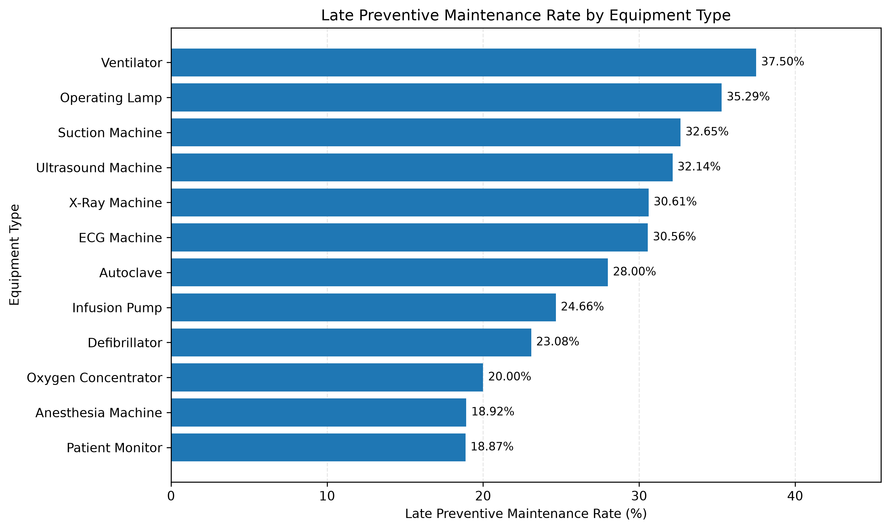
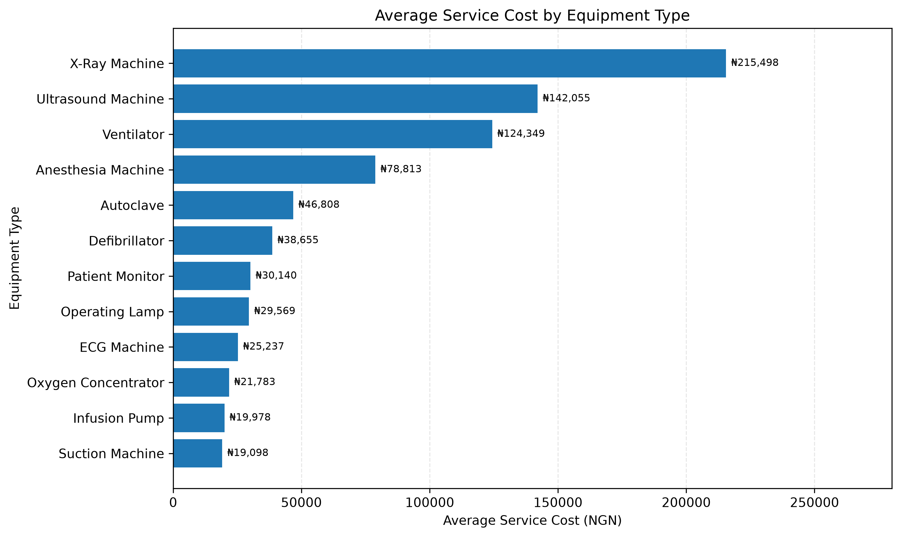
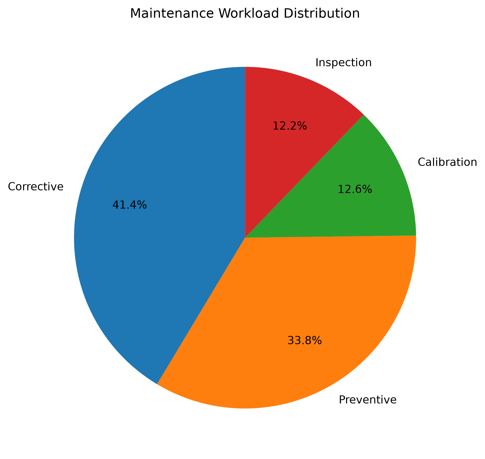

# Biomedical Equipment Maintenance Data Analysis

## Project Overview

This project analyses medical equipment maintenance records to identify patterns in maintenance workload, preventive maintenance compliance, and service costs across different types of hospital equipment.

The analysis uses Python to process the dataset, calculate summary statistics, and create visualisations that support data-driven maintenance planning.

## Objectives

* Examine the distribution of maintenance activities.
* Assess preventive maintenance timeliness across equipment categories.
* Compare average service costs by equipment type.
* Identify equipment categories that may warrant further maintenance review.

## Tools and Technologies

* **Python** — data analysis
* **Pandas** — data manipulation and analysis
* **Matplotlib** — data visualisation
* **openpyxl** — reading the Excel dataset
* **PyCharm** — development environment

## Key Findings

* **Maintenance workload:** Corrective maintenance represents 41.4% of the 1,500 records, making it the largest maintenance category.
* **Preventive maintenance:** Of 507 records with an applicable preventive maintenance status, 72.8% were on time and 27.2% were late.
* **Service costs:** X-ray machines recorded the highest average service cost, at approximately ₦215,498.
* **Late maintenance:** Ventilators had the highest late preventive maintenance rate at 37.5%, while infusion pumps had the highest number of late records, at 18.

## Visualisations

### 1. Preventive Maintenance Late Rate

### 2. Average Service Cost by Equipment Type

### 3. Maintenance Workload Distribution

## Limitations

The findings describe patterns in the available dataset. They do not establish the causes of maintenance delays, equipment failures, or differences in service costs. Further investigation would be required before making operational decisions.

## Conclusion

This project demonstrates how Python-based data analysis can be applied to biomedical engineering maintenance records to examine workload distribution, preventive maintenance timeliness, and service cost patterns.

The analysis can help identify areas for further investigation when planning maintenance activities and managing hospital equipment.
